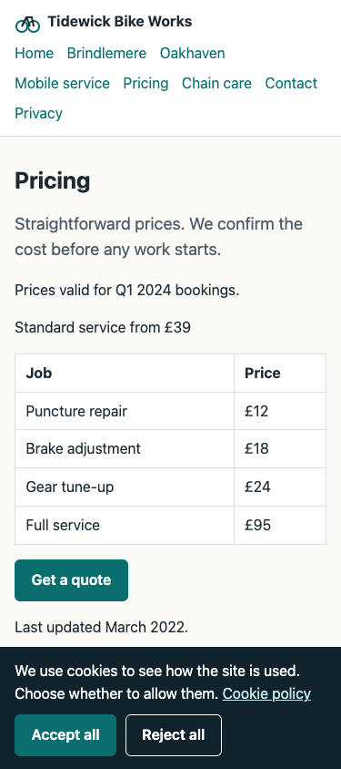
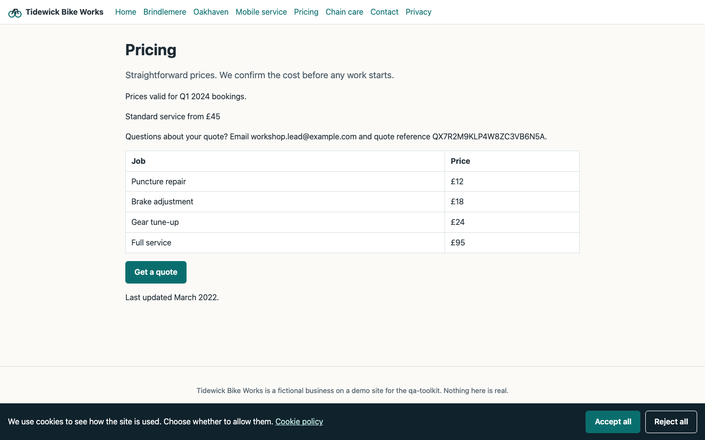
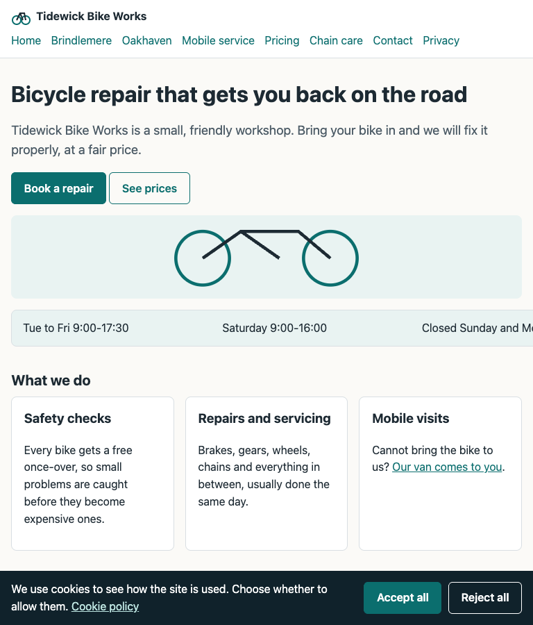

# Tidewick Bike Works: site audit (sample)

Run `tidewick-demo-2026-07-15`. Target: the fictional demo site on a local server. Read-only.
This sample covers the headless checks of an audit; see the coverage table for what a full
audit adds. Findings that a screenshot can show have one embedded beneath them.

## 1. Executive summary

The verdict is **FAIL**. The home page sets an analytics cookie before the visitor makes any
consent choice, and the pricing page sets one after the visitor chooses Reject. Both are
critical under the consent severity mapping. Five major findings follow: a vendor missing
from the privacy policy, a heading hidden under a fixed header, a price that differs
between phone and desktop, two near-duplicate location pages, and placeholder text on the
contact page. Eight minor findings are listed after those. The clean control page raised
nothing in any check.

## 2. Verdict

**FAIL**, by rule: two S2 findings are open (TDW-01, TDW-02).

| Severity | Count |
|---|---|
| S1 Blocker | 0 |
| S2 Critical | 2 |
| S3 Major | 5 |
| S4 Minor | 8 |
| Improvement ideas (not defects) | 2 |

Priorities below are recommendations for the product owner to confirm.

## 3. Charter and coverage

- **Goal:** find what a first-time visitor, a search engine and a privacy check would trip over.
- **Scope in:** the eight public pages of the demo site.
- **Scope out:** submitting the contact form; any sign-in; code review.
- **Environment:** local demo server; headless Chrome with a fresh profile per check; widths
  320, 375, 768, 1024 and 1440 CSS px (mobile widths emulated); consent checks at 375 and 1366.
- **Top risks:** tracking before consent; layout breaks between phone and desktop widths;
  copied or stale content.
- **Oracle:** the skill's severity mapping and default severities; the site's own privacy
  policy; consistency between pages.

| Area | Status | What ran, and what did not |
|---|---|---|
| Consent and tracking | Executed | Before any choice, after Accept and after Reject, on 3 pages at 2 widths; vendors compared with the policy |
| Viewport matrix | Executed | 5 pages at 5 widths: overflow, header clearance, text parity |
| Leftover debug code | Executed | 5 pages: hidden markup, console and page errors, failed requests, source maps |
| Duplicate content | Executed | 3 location-style pages, town names masked |
| Copy freshness | Executed | 8 pages, dated 15 July 2026 for the season check |
| Browser walk and global chrome gate | Not executed | No executor in this sample |
| Accessibility | Not executed | No scan, no keyboard walk |
| Performance | Not executed | No lab runs |
| Security headers, TLS, exposed paths | Not executed | Local server |
| CMS and code | Not applicable | Out of charter |

Each top risk had executed coverage.

## 4. Findings

Evidence files are in `evidence/`. "Reproduced" means the same result at both widths, each
from its own fresh browser profile.

### TDW-01 (S2 / P1, independently reproduced 2/2): an analytics cookie is set before any consent choice
1. Open the home page in a fresh profile. Do not touch the banner.
- **Expected:** no non-essential cookie until the visitor accepts.
- **Actual:** a `_ga` cookie is present before any click.
- **Evidence:** `consent.json`, `preConsentTracking` for `index.html`.

### TDW-02 (S2 / P1, independently reproduced 2/2): Reject on the pricing page still sets an analytics cookie
1. Open the pricing page in a fresh profile. 2. Choose Reject. 3. Reload.
- **Expected:** no analytics cookie after Reject, as on the home and contact pages.
- **Actual:** a `_hjid` cookie is set after Reject.
- **Evidence:** `consent.json`, `reject.rejectHonoured: false` for `pricing.html`.

### TDW-03 (S3 / P2, evidence reviewed): a vendor that loads after Accept is not in the privacy policy
- **Actual:** after Accept, a session-recording style cookie is set; the policy names one
  analytics vendor only.
- **Evidence:** `consent.json`, `policyCheck` with `mentionedInPolicy: false`.

### TDW-04 (S3 / P2, evidence reviewed): the fixed header covers the heading on the mobile service page
- **Actual:** at all five widths the top of the H1 sits under the header.
- **Expected:** the heading starts below the header, as it does on the other pages.
- **Evidence:** `overflow.json`, `headerClearsH1: false` for `mobile-service.html`.

### TDW-05 (S3 / P2, evidence reviewed): the standard service price differs between phone and desktop
- **Actual:** phone widths show £39; desktop widths show £45.
- **Evidence:** `overflow.json`, `parity` for `pricing.html`.

### TDW-06 (S3 / P3, evidence reviewed): two location pages are near-duplicates
- **Actual:** the Brindlemere and Oakhaven pages are flagged as near-duplicates once the town
  names are masked. Neither is flagged against the mobile service page.
- **Evidence:** `similarity.json`.

### TDW-07 (S3 / P2, evidence reviewed): placeholder text is visible on the contact page
- **Actual:** a paragraph of lorem ipsum is shown to visitors.
- **Evidence:** `copy.json` (`placeholder`), `artefacts.json` (`domHits`, visible).

### Minor findings (S4)

| ID | Finding | Page | Evidence |
|---|---|---|---|
| TDW-08 | Sideways scroll of 128 px at 768 px wide; clean at the other four widths | Home | `overflow.json` |
| TDW-09 | A past quarter (Q1 2024), "last updated" 2022 and a 2021 copyright year | Pricing | `copy.json` |
| TDW-10 | "GMT" shown while the UK is on summer time | Contact | `copy.json` |
| TDW-11 | Debug and test markup left in the page, some hidden, some injected by script | Pricing, Contact | `artefacts.json` |
| TDW-12 | A source map is publicly reachable next to its script | Pricing | `artefacts.json` |
| TDW-13 | An uncaught script error on load | Mobile service | `artefacts.json` |
| TDW-14 | A request for a missing resource, with console errors | Contact | `artefacts.json` |
| TDW-15 | The page title does not match the page's address | Mobile service | `copy.json` |

TDW-08, the opening-hours strip running off the right edge at 768 px:

TDW-09 is rated at the default. It would rise to S3 if the stale quarter is the offer
people book against; that is a question for the owner.

Root causes were not investigated.

## 5. Improvement ideas

- **IMP-01:** give each location page its own local detail (staff, directions, a photo,
  opening hours). It removes the duplicate risk and gives each page a reason to exist.
- **IMP-02:** end every page with the same clear next step. Not measured here; a browser
  walk would show where pages dead-end.

## 6. Evidence index

| File | What it holds |
|---|---|
| `evidence/consent.json` | Cookies, storage and request hosts before consent, after Accept and after Reject; policy comparison |
| `evidence/overflow.json` | Overflow, header clearance and text parity per page and width |
| `evidence/artefacts.json` | Debug markup, console and page errors, failed requests, source maps |
| `evidence/similarity.json` | Pairwise similarity of the location-style pages |
| `evidence/copy.json` | Stale dates, placeholder text, timezone label, title and address mismatch |

| `screenshots/` | Top-of-page captures saved by `viewport_overflow.js --shots`, embedded under the findings they support |

The screenshots are the script's own captures. A full audit adds the executor's walk, with
a screenshot under every visual finding.

## 7. Regression

First run for this target. Nothing to compare.

## 8. Next steps

1. Fix TDW-01 and TDW-02, then re-run `consent_capture.js` on the same three pages.
2. Fix TDW-03 to TDW-07 in the next release.
3. Run the parts this sample left out: a browser walk with the global chrome gate, an
   accessibility scan with a keyboard walk, and performance lab runs.
