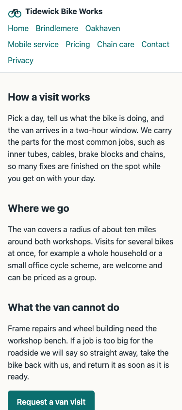

# Tidewick Bike Works: audit summary

Sample run `tidewick-demo-2026-07-15` against the fictional demo site. Headless checks only.

**Verdict: FAIL.** Two critical privacy problems are open: the site sets an analytics cookie
before the visitor has chosen anything, and on the pricing page choosing Reject does not
stop one being set.

## Scores (0 to 10)

| Area | Score | Why |
|---|---|---|
| Security and privacy | 0 | Tracking before consent, Reject ignored on one page, a vendor missing from the policy |
| User experience | 5.5 | A header covers a page heading; a price differs between phone and desktop; sideways scroll on tablets |
| Content | 6.5 | Placeholder text on the contact page; stale dates on pricing |
| Search and AI visibility | 7.5 | Two location pages are near copies of each other |
| Functional | 8.0 | A script error and a failed request, no visible effect found |
| Accessibility | Not scored | Not tested in this run |
| Speed | Not scored | Not tested in this run |

Every scored area was only partly covered, so no score here is higher than 8.

## The five things to fix first

1. **Stop setting the analytics cookie before consent** on the home page.
2. **Make Reject work on the pricing page.** It works on the home and contact pages.
3. **Name every vendor in the privacy policy.** One that loads after Accept is missing.
4. **Move the page heading out from under the fixed header** on the mobile service page.

   

5. **Show one standard service price.** Phones show £39 and desktops show £45.

## Quick wins

- Replace the placeholder text on the contact page.
- Update the dates on the pricing page and the timezone label on the contact page.
- Remove the leftover debug markup and the public source map.

## What was not covered

No one walked the site in a browser, so navigation, forms, menus and the cookie banner's
appearance were not assessed. Accessibility and speed were not tested. Security headers
were not checked because the demo runs on a local server.
